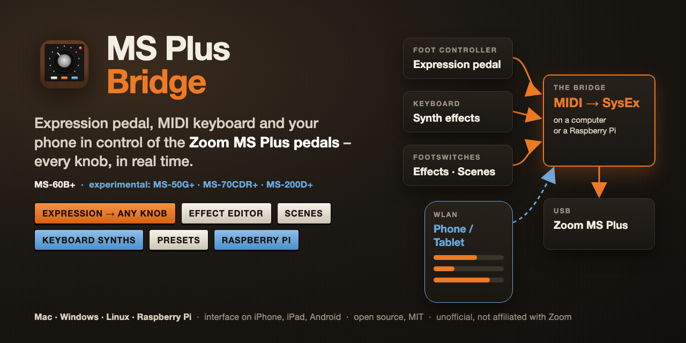

# MS Plus Bridge



Control a **Zoom MS-60B+** from an expression pedal, MIDI controllers, a MIDI keyboard and your phone –
every knob of every effect, in real time.

The pedal itself only accepts preset changes over MIDI. This bridge runs on a computer (or a
Raspberry Pi) between your controllers and the pedal and translates their messages into the pedal's
own commands.

> **Unofficial and at your own risk.** The pedal's commands were reverse engineered; Zoom does not
> document or support them. Back up your patches first. Not affiliated with Zoom, M-Vave or Line 6.
>
> **Other MS Plus pedals (MS-50G+, MS-70CDR+, MS-200D+) are experimental:** built and tested on the
> MS-60B+ (firmware 1.20) only.

## What it does

- **Expression pedal on any knob** – link a knob with one tap, set heel and toe, invert, choose a curve.
  Knobs, sliders and footswitches of other controllers work the same way.
- **Effect editor** – change, move, add and delete the effects of a preset and turn their knobs,
  with the pedal's own value texts and a meter of how much processing power (DSP) is left.
- **Presets** – choose, save (with undo) and rename them.
- **Scenes** – store a set of knob values and on/off switches and recall it with one footswitch.
- **Effects on and off** from footswitches of your controller.
- **Keyboard synths** – a MIDI keyboard plays synth effects that run on the pedal (up to four voices),
  with pitch wheel, arpeggiator and step sequencer. *The synth effects are not included, see below.*
- **On a phone or tablet** – the whole interface in the browser over the WLAN.
- **Raspberry Pi** – runs without screen, opens its own WLAN for the phone, takes Bluetooth MIDI
  controllers.

## What you need

- A **Zoom MS-60B+** on USB.
- A **computer** with Python 3.9 or newer – macOS, Windows or Linux – or a **Raspberry Pi** (tested: Pi 4).
- Optional: a **foot controller** whose expression pedal sends a MIDI CC (tested: M-Vave Chocolate Plus),
  a **MIDI keyboard** (tested: Komplete Kontrol A61), a **phone or tablet**.

## Getting started

Download this repository (green **Code** button → **Download ZIP**), unpack it and start it:

| System | Start |
|---|---|
| macOS | double-click `Start Bridge.command` (first time: right-click → Open) |
| Windows | double-click `Start Bridge.bat` |
| Linux | run `./Start Bridge.sh` in a terminal |

The first start sets everything up by itself; the interface opens in your browser. Then connect the
pedal once, step by step: **[Quick start](QUICKSTART.md)**.

## On a phone or tablet

iPhone, iPad and Android cannot run the bridge, but they use its interface in the browser:

- **With a computer:** set `listen: true` under `ui:` in `config.yaml` (or start with `--listen`).
  The bridge shows the address to open, e.g. `http://192.168.1.20:8765`. Anyone in that WLAN can then
  use it – only do this in your own WLAN.
- **With a Raspberry Pi:** join the Pi's WLAN "MS Plus Bridge" and open `http://10.42.0.1`.

Type the address with `http://`. Brave on iOS needs "Local Network" allowed in the iOS settings.

## On a Raspberry Pi

Set the bridge up on your computer first, then put the Pi's SD card (Raspberry Pi OS, made with
Raspberry Pi Imager) into the computer and double-click `Write Pi Card.command` (Windows, Linux:
`.venv/bin/python export.py`). At its first start the Pi installs everything by itself – it needs the
internet once – and from then on starts the bridge whenever it is switched on.

Where no known WLAN is around, the Pi opens its own: **MS Plus Bridge** (the password is shown on the
computer under *Export…*). Bluetooth MIDI controllers connect when you switch them on near the Pi.

## Keyboard synths

A MIDI keyboard can play synth effects on the pedal: **KeySynth, KeySweep, KeyFM, KeyPoly, KeyWave,
KeyBand, Pluck**. **The effects are not part of this repository** – they are published separately.

1. Install them on the pedal with Zoom's installer. Keep a backup: a custom effect can make a pedal unusable.
2. Enter your keyboard under `synth:` in `config.yaml` and start the bridge again.
3. Put one of the effects into a preset and play. After installing new versions, click **Read Pedal**.

## Safety

- Back up your patches with Zoom's software before the first start.
- Every message the bridge sends is on a fixed list, and each kind needs your approval once
  (`probe.py approve`); everything sent and received is logged in `logs/sysex.log`.
- Close other software that talks to the pedal (Zoom's editor, a DAW) while the bridge runs.

## If something does not work

- The **Activity** box in the interface says what the bridge did and why.
- The foot controller sends nothing over USB? On the Chocolate Plus switch Bluetooth off (hold B + C).
- The pedal is not found: unplug it and plug it in again; the bridge connects by itself.
- More: [Reference](docs/REFERENCE.md) – every feature in detail, what was measured on the pedal.

## For developers

```bash
.venv/bin/python -m unittest     # the tests run against a simulated pedal
```

## Credits

[zoom-explorer](https://github.com/thammer/zoom-explorer) and
[stomphacks](https://github.com/thammer/stomphacks) by thammer,
[zoom-zt2](https://github.com/mungewell/zoom-zt2) by mungewell,
[mido](https://github.com/mido/mido) and [python-rtmidi](https://github.com/SpotlightKid/python-rtmidi).

## License

MIT, see [LICENSE](LICENSE).
